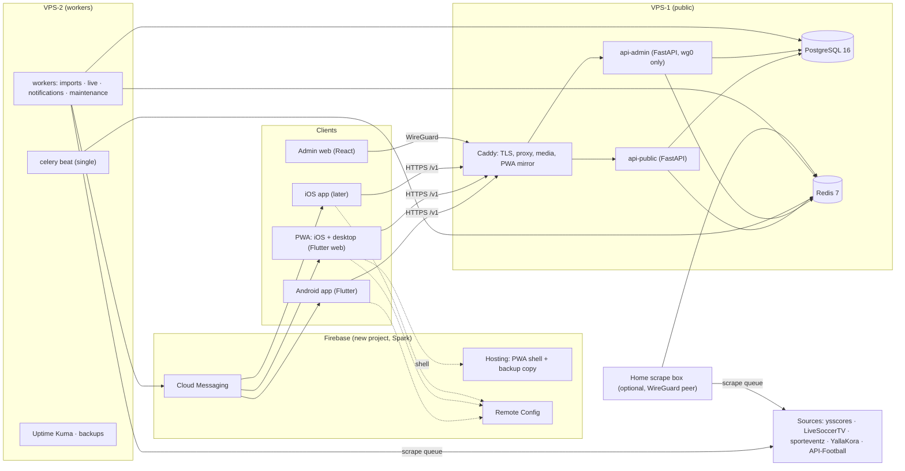

# Madar Sat — System Design

| | |
|---|---|
| Status | Draft 1, 2026-10-28 |
| Replaces | Sat Air 3.8 (`com.satair.app`, versionCode 28). Recovered source: `old_app/` |
| Companion | [product-business.md](product-business.md): product scope, screen specs, design-system requirements |
| Readers | Engineers building the backend, admin and app. Claude Design reads §5.3, §6.2–6.3 and §11 for platform limits and data shapes |

The brand is **Madar Sat** (مدار سات). The package ID is still open (O1 in §3.2).

---

## 1. Context

### 1.1 What exists today

Sat Air 3.8 is an Arabic, right-to-left, Android-only app. It's a Capacitor 8 shell around a React 18 web bundle. It answers one question for Arab football fans who watch on a satellite dish: *which channel shows this match, on which satellite, and at what frequency?*

```
Phone (Capacitor WebView)
 ├─ GET satair-6983b.web.app/data/*.json      ~1.5 MB on first start (channels.json alone: 977 KB)
 ├─ Firestore listeners: matchDays/{date} × 4 days; feeds (only while that tab is open)
 ├─ AdMob banner + interstitial (≥90 s apart); local notifications 15 min before favourite-team matches
 └─ IndexedDB image cache; localStorage for every other cache and setting
Admin (/admin route in the same bundle) ── writes Firestore directly; Firebase Auth + UID check in the browser
 └─ "Publish" tab: the admin downloads 7 JSON files and deploys them to Firebase Hosting by hand
Importers: standalone HTML pages, run by hand in a browser
 ├─ IMPORT.html (ysscores) · LVS.html / fetch-channels.html (LiveSoccerTV, through a Cloudflare Worker proxy)
 └─ SPORTS.html (sporteventz) · auto-import.html (YallaKora; a half-finished API-Football integration)
Media: public Cloudflare R2 bucket (pub-01ffc…r2.dev) + imgs.ysscores.com. R2 keys are pasted into the admin's browser
Web: satair-6983b.web.app shows a "get it on Google Play" page; ?app=1 opens a password gate (SHA-256 hash in the bundle)
```

### 1.2 Data volumes (snapshot of 2026-10-28)

| Entity | Count | Notes |
|---|---|---|
| Matches | 470 over 7 days (17–97 a day) | 8–27 competitions a day. Channels per match: median 2, max **171**. 166 matches (35 %) have none |
| Channel rows ("carriages") | 2,418 | 949 sit on a satellite. 1,469 are broadcaster or platform rows with a country but no satellite |
| Satellites | 32 | Hotbird 13E 189 channels, Eutel 16E 134, Astra 19.2E 101, Badr 26E 69, Nilesat 7W 63, Amos 4W 20 |
| Competitions / teams | 134 / 1,513 | Team names aren't unique ("الأهلي" ×3) |
| Rights holders | 75 | 6 competitions each (median), up to 29 |
| Commentators | 119 (+37 found only on matches) | Each has a photo and a voice clip |
| LiveSoccerTV team dictionary | 937 | Arabic name → LiveSoccerTV slug |

### 1.3 Problems the new system fixes

1. **Heavy start.** Every cold start downloads about 1.5 MB of JSON. Lists are filtered on the phone.
2. **Admin saves aren't live.** Changes need an export-and-deploy step, so hosting lags Firestore (2,418 vs 2,435 channels).
3. **Authorization lives in the client.** The admin UID check runs in the browser, R2 secret keys sit in browser storage, and the web gate is a hash in public JS.
4. **Live scores are dead.** `ysMatchId` is stored, but the live-score map is never filled in. Status is guessed from the clock: "live" means kickoff to kickoff + 2 h.
5. **Imports are manual, and there's no history.** Matches live in a rolling 7-day window and older days are deleted.
6. **References are by name.** This leaves 65 ambiguous team references, orphan channel IDs and duplicated rows (see `old_app/migration/README.md`).
7. **Android only, with local notifications only.** There are no goal alerts and no alerts for channel changes.
8. **Unmaintainable code.** The app is one React component of 9,159 lines and the admin another of 8,120, with no tests.

---

## 2. Goals, non-goals, constraints

**Goals**

| # | Goal | Measure |
|---|---|---|
| G1 | Android app, iOS and desktop web from one Flutter codebase | Same feature set, except the native-only items in §5.3 |
| G2 | An admin edit shows in the app quickly | ≤ 60 s from save to client, with no publish step |
| G3 | Ingestion runs unattended and reports its health | Each source has a health page and alerts on failure |
| G4 | Server push | Reminders, goals, final scores, channel changes, frequency changes |
| G5 | Fast, offline-tolerant client | Cached first screen in < 1.5 s on a mid-range Android; home payload ≤ 60 KB gzipped |
| G6 | $0/month infrastructure | OCI Always Free + Firebase Spark + Backblaze free tier |
| G7 | Authorization checked on the server; no secrets in any client | Security checklist in §8 |

**Non-goals for v1:** user accounts, video streaming, an English UI (strings are externalized, so it's ready), multi-region HA.

**Constraints**

| Area | Constraint |
|---|---|
| Compute | 2 × OCI Ampere A1 (arm64). Together 2 OCPU / 12 GB, the whole Always Free allowance. Every image must be `linux/arm64` |
| DNS | No domain yet. Public hostnames use `sslip.io` on reserved public IPs |
| Firebase | New project on the Spark plan. Hosting: 10 GB stored, 360 MB/day transfer |
| Apple | No paid developer account yet, so iOS ships as a PWA until it's active |
| Data | Fixtures and channel lists come from scraping. ysscores blocks datacenter and Cloudflare IPs and returns 429 |
| Team | Small. Ops must stay boring: Docker Compose, no Kubernetes |

---

## 3. Decisions

### 3.1 Decided earlier

| # | Decision | Reason |
|---|---|---|
| D1 | Rebrand with a new package ID, Play listing and Firebase project | Removes any dependency on the old listing, signing key or `satair-6983b` (owner access returns 403). Existing users don't migrate |
| D2 | Mobile is Flutter: Riverpod, go_router, Dio + Retrofit, feature-first clean architecture | One codebase for Android, iOS and web; solid RTL support |
| D3 | Until the Apple account exists, iOS gets the Flutter web build as a PWA | Same codebase. iOS users add it to the home screen from Safari |
| D4 | Admin is React + Vite + TS + Tailwind + React Query | It's a desktop data-entry tool, so a web stack fits |
| D5 | Backend is FastAPI + SQLAlchemy 2 (async) + Alembic + Pydantic v2, with Celery + beat, PostgreSQL 16 and Redis 7 | `schema.sql` becomes the first Alembic migration |
| D6 | Keep scraping, with one Celery adapter per source. Free APIs plug in as more adapters | No budget for a licensed feed. See risk R1 |
| D7 | VPS-1 runs the public app and data; VPS-2 runs the workers | The app mostly reads, so the API sits next to the database |
| D8 | The PWA shell lives on Firebase Hosting (`<project>.web.app`), with app files mirrored on VPS-1 | The address stays fixed for life, and the Spark quota is barely touched (§5.2) |
| D9 | No CDN. Caddy, Redis and client caching carry the load | The free tiers allow it. OCI includes 10 TB/month egress |
| D10 | Admin panel, admin API and SSH are reachable only over WireGuard. The admin API is a separate app bound to `wg0`. Caddy uses `tls internal` | Admin routes don't exist on the public listener at all |
| D11 | App config comes from Firebase Remote Config, not Realtime Database | Spark RTDB allows only 100 concurrent connections |
| D12 | Push goes through FCM everywhere, using `firebase_messaging` on Android, web and iOS | One delivery channel for the backend |
| D13 | Media lives on VPS-1's disk, served by Caddy, with a copy in the OCI bucket. Offsite backups go to Backblaze B2 | Object Storage allows only 50k requests a month, which is too few to serve from |
| D14 | One monorepo with per-folder workflows: GitHub Actions for Android, PWA and backend/admin; Codemagic for iOS later | One PR can change an endpoint and both generated clients |
| D15 | The recovered old source and the scraped snapshot stay out of the new repo's history | Copy `schema.sql` in, and git-ignore `migration/data/` |

### 3.2 Proposed in this document (confirm)

| # | Proposal | Reason |
|---|---|---|
| P1 | The device keeps its follows **and** mirrors them to the server under an anonymous device record. The server picks recipients itself (§6.8) instead of the app subscribing to FCM topics | Someone following both teams and the league gets **one** push, not three. It works the same on web, where clients can't subscribe themselves to topics. It allows per-device settings. Still no accounts |
| P2 | Group matches by the **user's local date**, computed from `kickoff_at`. The old app grouped by the Cairo listing day | An 01:00 Cairo kickoff belongs to a different day for a user in Riyadh or Paris |
| P3 | Clients poll one shared, cached `/v1/live` resource instead of opening WebSockets | Cache-friendly, cheap on 1 OCPU, and survives flaky mobile networks |
| P4 | An explicit match status model with an "estimated" flag (§6.2.3) | The UI must never present a clock guess as a real live score |
| P5 | Show the interstitial when the user **returns** from match detail, never before it opens | The old app showed it on open. The answer comes first, and revenue is mostly kept (product doc §5) |
| P6 | Use drift (SQLite, with a WASM build on web) for the offline cache, not Hive | Channel lists need filtered queries (by satellite, category, search). drift runs on web; Isar doesn't |

### 3.3 Open

| # | Question | Blocks |
|---|---|---|
| O1 | Package ID, for example `com.madarsat.app`. The ID can never change after the first upload | Store listing, Firebase apps |
| O2 | The v1 feature cut. Proposal in the product doc, §6 | Phase 3 scope |
| O3 | Whether to drop the card-sharing labels and BISS keys (risk R3) | Channel `access` field, Feeds screen |
| O4 | A domain (about $10/year) for the API and media hosts | Not urgent: hosts come from Remote Config, and the PWA lives on `web.app`. It removes the dependence on sslip.io (R6) |
| O5 | Apple enrollment as an individual (fast; personal name shown as seller) or an organization (needs a D-U-N-S number, takes weeks) | iOS native timeline |
| O6 | **Decided 2026-11-03: stay on Spark with the mirror design** (spec 004 Clarifications). Blaze was the alternative (costs cents, no cap) | §5.2: the mirror and service worker ship on D4 |
| O7 | **Decided 2026-11-04, changed 2026-11-05 after the first capture: scrape FilGoal, Goal.com and YallaKora**, at $0 (§6.7). Manual live entry was rejected, because there are no operators. A paid feed (API-Football Pro, about $19/month) stays the alternative if the capture fails. The owner accepts the risk of terms not yet read (R1). The first capture ran on 2026-11-04 from a home connection, and spec 031 acts on it. A capture from VPS-2 is still due. **Goal.com's terms forbid scraping and commercial use without consent. FootballCo approved on 2026-11-05, as the owner reports: scraping for scores, match stats and everything else spec 031 plans, with no conditions or exceptions** (R1) | Live match center (§6.7) |

---

## 4. Architecture overview



| Component | Runs on | Purpose |
|---|---|---|
| Flutter app | Android; iOS later | The product (§5.1) |
| Flutter web PWA | Firebase Hosting shell + VPS-1 mirror | iOS for now, plus desktop web (§5.2) |
| Admin web | Static files from Caddy on `wg0` | Content management and source operations (§5.4) |
| Caddy | VPS-1 | Let's Encrypt certificates for `*.sslip.io`, `tls internal` on `wg0`, zstd/gzip, security headers, static media and PWA mirror |
| api-public | VPS-1, `127.0.0.1:8000` | Read-mostly `/v1` API plus device endpoints |
| api-admin | VPS-1, `10.8.0.1:8100` | `/admin/api`: CRUD, operations, auth |
| PostgreSQL 16 | VPS-1, private IPs only | System of record |
| Redis 7 | VPS-1, private IPs only, ACL password, 512 MB maxmemory | API cache, Celery broker, locks, rate limits, live state |
| Celery workers + beat | VPS-2; the scrape worker can move to a home box | Ingestion, live polling, push, maintenance |
| Firebase | Google | Remote Config, FCM, Hosting, Crashlytics (native builds) |

---

## 5. Clients

### 5.1 Flutter app

**Structure** (feature-first clean architecture; each feature has `data/`, `domain/` and `presentation/`):

```
app/lib/
  core/        config · network (Dio, ETag, retry and device-auth interceptors) · db (drift) · platform/ · theme/ · l10n/ · router/
  features/    matches · match_detail · live · my_satellites · frequencies · channel · team · competition
               rights · feeds · follows · search · settings · onboarding · notifications · install_guide (web)
  main_dev.dart · main_staging.dart · main_prod.dart
```

**Key packages:** `flutter_riverpod` + `riverpod_generator`, `go_router`, `dio` + `retrofit` (generated from the OpenAPI spec with `swagger_parser`), `freezed`, `json_serializable`, `drift` (P6), `flutter_secure_storage` (device token), `cached_network_image`, `firebase_core`, `firebase_messaging`, `firebase_remote_config`, `firebase_crashlytics` (native only), `google_mobile_ads` (native only), `just_audio` (commentator clips, works on web), `share_plus`, `url_launcher`, `intl`. v2 adds `flutter_local_notifications`, `home_widget`, `geolocator` and compass sensors.

**Platform adapters.** Each native-only capability sits behind an interface, with a native implementation and a web no-op chosen by conditional import: `AdsService`, `LocalNotifier`, `HomeWidgetUpdater`, `CrashReporter`, `InstallGuide` (web only). Feature code never imports a plugin directly.

**Data flow (stale-while-revalidate).** The repository emits the drift copy immediately. It then sends a request with `If-None-Match`; a `200` updates drift and emits again, a `304` changes nothing. Screens show a "last updated" hint when the copy is older than its freshness target (§11).

| Dataset | Kept on device | Refresh |
|---|---|---|
| Matches | Local days today−1 … today+6. Older days fetched when opened | On open, on pull-to-refresh, every 60 s while visible |
| Live states | In memory | `/v1/live` every `live_poll_interval_s` while a live or imminent match is visible and the app is in the foreground |
| Channels | All carriages: full sync once, then deltas (§6.3.3) | On start, then every 6 h |
| Satellites, competitions, rights holders, commentators | Full set | ETag check on start |
| Follows, my satellites, preferences | Device is the source of truth; follows mirrored to the server (P1) | On change |

**Remote Config keys** (bundled defaults; fetched on start; live updates on mobile only):

| Key | Example | Used for |
|---|---|---|
| `api_base_url`, `media_base_url` | `https://api.<ip>.sslip.io` | Lets the host move without an app release |
| `min_supported_build` / `latest_build` | `12` / `15` | Forced update screen / soft "update available" banner |
| `maintenance` | `{"on":false,"message_ar":""}` | Maintenance screen |
| `ads` | `{"enabled":true,"interstitial_min_interval_s":90,"interstitial_session_cap":4}` | Ad pacing (Android) |
| `features` | `{"live_center":true,"lineups":false,"reports":false,"satellite_finder":false}` | Feature flags and percentage rollouts |
| `live_poll_interval_s` | `30` | Client live polling |

**Build flavors:** dev, staging and prod, set with `--dart-define-from-file=env/<flavor>.json`. These files hold only public values: Firebase options are identifiers, not secrets. They are kept out of the repo all the same (only `env/example.json`, the list of keys, is committed): each building machine keeps its own copy, and CI writes `env/prod.json` from the `APP_ENV_PROD` GitHub secret. No API keys or credentials go in Dart source.

**Localization:** ARB files, Arabic only in v1, layout forced RTL. Always render **Western digits (0–9)**. Don't rely on the `ar` locale default, because some `intl` locales emit Arabic-Indic digits. Times use `ص`/`م` in 12-hour mode.

### 5.2 PWA delivery (iOS interim + desktop web)

```
<project>.web.app (Firebase Hosting)  index.html · flutter_bootstrap.js · manifest · sw.js · firebase-messaging-sw · icons   (a few KB per open)
        │  The service worker fetches each content-hashed app file from the first source that answers (≈3 s timeout each):
        ├─ 1. its own cache          (a hashed file is downloaded once, ever)
        ├─ 2. VPS-1 mirror           https://app.<ip>.sslip.io/…   (CORS allows the web.app origin)
        └─ 3. Firebase               (CI deploys the full build here too, as a backup)
```

- **Build:** `flutter build web --release` with content-hashed file names; check the exact flag against the pinned Flutter version. `flutter_bootstrap.js` sets `entrypointBaseUrl` and `assetBase` to the mirror. Bundle the Arabic font subset so the app never downloads fallback fonts at runtime.
- **Headers:** `index.html`, `flutter_bootstrap.js` and the service worker get `Cache-Control: no-cache`. Hashed files get `public, max-age=31536000, immutable`. Set them in `firebase.json` and in the Caddyfile.
- **Service worker:** a custom one handles caching, mirror failover and FCM background messages. FCM requires `firebase-messaging-sw.js` at the origin root, so its logic is merged into or imported by the main worker.
- **Failure modes:** Firebase over quota → existing users load the shell from cache and files from VPS-1. VPS-1 down → files come from Firebase. Both down → the cached app opens and API screens show their offline state. If Firebase is down, new installs can't happen; an emergency install link on `app.<ip>.sslip.io` is a separate app with its own push permission, so only publish it during an outage. Uptime Kuma watches both.
- **iOS limits:** push works only after "Add to Home Screen" plus a user-initiated permission prompt, on iOS 16.4 or later. There's no install prompt, so the app shows its own install guide (product doc, S1.5). No AdMob, widgets, local reminders or background refresh.

### 5.3 Platform capabilities (they shape the UI)

| Capability | Android app | iOS PWA | Desktop web | iOS app (later) |
|---|---|---|---|---|
| Push | ✓ | Only after install + tapping Allow | ✓ (Chrome, Edge, Firefox, Safari on macOS) | ✓ |
| Scheduled local notifications | ✓ (not used in v1; server pushes reminders) | ✗ | ✗ | ✓ |
| Ads | AdMob banner + interstitial | None (ad-free) | None | AdMob |
| Home widget, ongoing live notification / Live Activity | v2 | ✗ | ✗ | v2 |
| Commentator voice clips | ✓ | ✓, after a tap | ✓ | ✓ |
| Location + compass (satellite finder, v2) | ✓ | ✓ with permission (iOS asks separately for motion) | ✗ (no compass) | ✓ |
| Share | Native sheet | Web Share | Copy link | Native sheet |
| Back navigation | System back; root shows "press back again to exit" | Edge swipe | Browser back, deep links | Edge swipe |
| Install | Play Store | Manual "Add to Home Screen" guide | Browser install prompt | App Store |
| Crash reporting | Crashlytics | Logged to API (or Sentry, optional) | Same | Crashlytics |

### 5.4 Admin web

- React 18, TypeScript strict, Vite, Tailwind v3 (tokens in `tailwind.config`), React Query, React Hook Form + Zod, React Router v6. The API client and Zod schemas are generated by Orval from the admin OpenAPI spec.
- Served by Caddy on `wg0` at `https://10.8.0.1`, with the API at `/admin/api` on the same origin, so no CORS. Caddy's internal CA root is installed once on each admin device.
- Arabic RTL UI, desktop-first (1440 baseline, usable at 1024).
- Session handling: access token in memory; refresh token in an `HttpOnly; Secure; SameSite=Strict` cookie; refresh requests also send a CSRF header.

---

## 6. Backend

### 6.1 Processes and queues

| Process | Host | Notes |
|---|---|---|
| `api-public` | VPS-1 | gunicorn + 2 uvicorn workers. Public routes only |
| `api-admin` | VPS-1 | 1 worker, bound to `wg0` |
| `worker-imports` | VPS-2 | Normalize, upsert, entity resolution, media rehosting |
| `worker-scrape` | VPS-2, or the home box if OCI IPs get blocked | Fetch and parse only. Concurrency 1–2 |
| `worker-live` | VPS-2 | Concurrency 1 |
| `worker-notify` | VPS-2 | Concurrency 2 |
| `worker-maintenance` | VPS-2 | Cleanup, media copy, dataset versions |
| `beat` | VPS-2 | Exactly one instance, ever |

Queues: `scrape`, `imports`, `live`, `notifications`, `maintenance`. Every task uses `bind=True` with `autoretry_for`, `retry_backoff=True`, `retry_jitter=True` and a bounded `max_retries`. Tasks are idempotent because they upsert by external ID. A Redis lock (`SET NX EX`) stops runs of the same job from overlapping.

The code is one Python package (`backend/app`) with two ASGI entry points, `app.public:app` and `app.admin:app`. They share models, schemas and services, so admin routers are never mounted on the public app.

### 6.2 Data model

**6.2.1 Base.** `old_app/migration/schema.sql` becomes Alembic revision `0001` unchanged, together with the ETL rules in `old_app/migration/README.md`. Run it as one script through psycopg; SQLAlchemy on asyncpg rejects several statements in one call. Besides the Sat Air data, the base already holds:

- `sources`, which every provenance column, external id and import run references;
- `media_assets`: every logo, photo and voice clip is an `*_asset_id`, never a URL, so the API builds absolute URLs from `media_base_url`;
- `match_external_ids`, `team_external_ids` and `competition_external_ids`, keyed by `(source, external_id)`, for importer upserts;
- `channels.kind` (`satellite`, `terrestrial` or `platform`), `access` (`free` / `encrypted`), `provider`, `package`, `beam` (`wide` / `narrow`), and soft delete (`deleted_at`); `encryption` is not loaded (O3);
- `satellites.slug`, `kind` and `orbital_position numeric(4,1)` (east positive);
- `ar_normalize` (6.2.4), with generated `name_norm` columns on teams, competitions, channels and commentators;
- a `set_updated_at` trigger that moves `updated_at` only on a real change, and a trigger that refuses to delete matches.

Later revisions add:

| Table / change | Purpose |
|---|---|
| `matches`: `status`, `period`, `minute`, `home_score`, `away_score`, `home_pen`, `away_pen`, `status_source`, `status_label`, `status_updated_at`, `time_tbd`, `locked_fields text[]` (CHECK against the lockable columns; drop `is_live` once status is backfilled) | Live model (6.2.3); protects admin edits from importers |
| `match_events (id, match_id, side, type, minute, player_name, source, external_id)`, unique `(match_id, source, external_id)` | Goals, own goals, penalties, red cards (live center). The unique key stops the live diff inserting a goal twice |
| `match_lineups (match_id, side, formation, players jsonb, source)` | Lineups, where the source has them (O7) |
| `channels`: `locked_fields` (CHECK as on matches), `frequency_changed_at` | Protects admin edits; the "changed recently" badge |
| `channel_frequency_changes (id, channel_id, old_*, new_*, source, detected_at)` | Frequency-change alerts and the "changed recently" badge |
| `team_aliases`, `competition_aliases`, `channel_aliases (source, alias_norm, target_id)`, `unresolved_names` | Entity resolution and the admin mapping queue |
| `pg_trgm` GIN indexes on the `name_norm` columns | Arabic-insensitive search (6.2.4) |
| `admin_users`, `admin_refresh_tokens`, `audit_log` | Server-side admin auth and accountability |
| `devices (id, install_id uuid, token_hash UNIQUE, platform, push_token UNIQUE, app_version, locale, tz, prefs jsonb, created_at, last_seen_at)` | Anonymous device registration. A push token belongs to one device row, so a re-registered token can't receive the same push twice |
| `device_follows (device_id, team_id, competition_id, match_id, channel_id, commentator_id, created_at)`: one nullable FK per target type, with a CHECK that exactly one is set | Follows. Real foreign keys keep follows valid through merges and deletes, unlike a `(target_type, target_id)` pair |
| `notification_outbox (id, type, dedupe_key UNIQUE, payload jsonb, audience jsonb, due_at, status, sent, failed)`, partial index on `due_at` where `status = 'pending'` | Reliable, deduplicated push; the index serves the dispatcher's `SKIP LOCKED` claim |
| `reports (id, device_id, match_id, channel_id, kind, note, status, resolved_by, created_at)` | "Channel not working / wrong frequency" (v2) |
| `import_runs` + `items_found`, `items_upserted`, `http_errors`, `status`, `raw_path` | Source health |
| `dataset_versions (name, version bigint, updated_at)`. Bump a version as the last statement of a write transaction, or use one sequence per dataset, so a long import doesn't hold the row lock that admin saves wait on | Cheap ETags and cache invalidation |

**6.2.2 Time.** `kickoff_at timestamptz` holds UTC. Importers read source wall-clock times in their real zone: Cairo for the Arabic sources, converted with `AT TIME ZONE 'Africa/Cairo'` so DST is handled. `match_date` keeps the legacy listing day for ingestion only. `time_tbd = true` when the kickoff time is unknown; clients put those matches in a "time to be confirmed" group for their `match_date`.

**6.2.3 Match status.**

```
scheduled ─▶ live(1H) ─▶ halftime ─▶ live(2H) ─▶ [extra_time ─▶ penalties] ─▶ finished
scheduled ─▶ postponed | cancelled          live ─▶ abandoned
```

- `status_source` is `feed`, `manual` (admin override) or `clock`.
- The clock fallback applies only when no feed covers a match: from kickoff to kickoff + 120 min it's `live`, after that `finished`. These carry `estimated: true` in the API, and the UI shows "live" without a score or minute.
- A `feed` match that no source closes can be finished at a limit (§6.7). It keeps its last accepted score and stays `feed`, with no `estimated`, and the owner gets an alert. That's an inference, recorded as an exception to Honest Data in spec 031's plan. Past kickoff + 150 min, a match that reached the second half doesn't go back to the clock.
- `minute` is text (`"45+2"`). `status_label` carries a source label for unusual states, such as the reason for a postponement.

**6.2.4 Search.** An immutable SQL function `ar_normalize(text)`, defined in the base schema, strips tashkeel and tatweel, maps أ/إ/آ/ٱ → ا, ى/ئ → ي, ؤ → و and ة → ه, turns punctuation into spaces and lowercases Latin text. It gives the same result as the old app's `normalizeArabic` on all 4,786 distinct names in the snapshot. Unique keys use it too: competitions per `(sport, name_norm)`, commentators per `name_norm`, channel carriages and platforms. Generated `name_norm` columns plus `pg_trgm` serve `/v1/search` and the admin pickers.

**6.2.5 History.** Matches are never deleted. That's about 25k rows a year, which needs no partitioning. Raw scraped HTML is kept for 5 days. Outbox rows are kept for 30 days.

### 6.3 Public API (`/v1`)

**6.3.1 Conventions**

- Response envelope: `{"success": true, "data": …, "error": null, "meta": {…}}`. Errors look like `{"success": false, "data": null, "error": {"code": "match_not_found", "message": "…"}}`. Clients map `code` to Arabic copy; `message` is for logs.
- Timestamps are ISO-8601 UTC, and clients format them. IDs are integers. Media URLs are absolute.
- Long lists use cursor pagination (`meta.next_cursor`).
- Every GET returns an `ETag`. The client sends `If-None-Match`, and a `304` costs almost nothing.
- Caddy compresses responses (zstd/gzip). Redis caches each response under a key built from the normalized query and the relevant dataset versions, so a write invalidates by bumping a version, not by scanning keys.

**6.3.2 Endpoints**

| Method & path | Returns | Cache | Used by (product doc §9) |
|---|---|---|---|
| `GET /v1/matches?from&to&sport&competition_id&team_id&satellite_ids&status` | `MatchSummary[]` for a UTC window (the client sends its local-day bounds) | 60 s | S2, S4, S7, S8 |
| `GET /v1/matches/{id}` | `MatchDetail` | 60 s (15 s while live) | S3 |
| `GET /v1/live` | Status, minute and score for every live, imminent or just-finished match | 15 s, shared | S2, S3, S4 |
| `GET /v1/satellites` | Satellites with channel counts | 1 h + ETag | S5, settings, onboarding |
| `GET /v1/satellites/{id}/channels?category&q` | Carriages on one satellite | 5 min | S5.2 |
| `GET /v1/channels/sync?cursor` | Carriage upserts + deleted IDs + next cursor | 5 min | Offline cache |
| `GET /v1/channels/{id}` | Carriage, other carriages of the same channel, upcoming matches, recent frequency changes | 5 min | S6 |
| `GET /v1/competitions`, `/v1/competitions/{id}` | List (with priority) / detail with rights holders | 1 h / 5 min | S8, settings |
| `GET /v1/teams/{id}`, `GET /v1/teams?q` | Team with upcoming and recent matches / search | 5 min | S7, onboarding |
| `GET /v1/rights-holders?satellite_id&competition_id`, `/v1/rights-holders/{id}` | Rights holders | 1 h | S11 |
| `GET /v1/commentators/{id}` | Profile + upcoming matches | 5 min | S17 (v2) |
| `GET /v1/feeds?date` | Feeds (if kept, O3) | 5 min | S12 |
| `GET /v1/search?q&types` | Teams, competitions, channels, commentators, satellites | 5 min | S14 |
| `POST /v1/devices` | `{device_id, device_token}` | no-store | First launch |
| `PUT /v1/devices/me` | Push token, app version, tz, locale, notification preferences | no-store | Settings, token refresh |
| `PUT /v1/devices/me/follows` | Replaces the follow set | no-store | Follow toggles (P1) |
| `DELETE /v1/devices/me` | Deletes the device and its follows | no-store | Settings → privacy |
| `POST /v1/reports` | Creates a report | no-store | S19 (v2) |

The device token is 256 random bits, generated by the server and stored there as a hash. The app keeps it in secure storage and sends it as `Authorization: Device <token>` on `/devices/me*` and `/reports`.

**6.3.3 Shapes (abridged; the OpenAPI spec is authoritative)**

```jsonc
// MatchSummary
{ "id": 48213, "sport": "football", "kickoff_at": "2026-10-28T18:00:00Z", "time_tbd": false,
  "status": "live", "estimated": false, "minute": "67", "score": {"home": 1, "away": 0, "home_pen": null, "away_pen": null},
  "competition": {"id": 12, "name": "الدوري المصري الممتاز", "logo": "https://media…/c/9f.webp", "stage": "الجولة 9"},
  "home": {"id": 101, "name": "الأهلي", "logo": "https://media…/t/1a.webp"},
  "away": {"id": 102, "name": "الزمالك", "logo": "https://media…/t/2b.webp"},
  "broadcast": {"channel_count": 14, "has_free": true, "headline": [{"channel_id": 5512, "name": "أون سبورت 1", "satellite_id": 2}]},
  "commentator": {"id": 7, "name": "…"} }

// MatchDetail = MatchSummary +
{ "stadium": "استاد القاهرة", "local_broadcaster_eg": "أون سبورت",
  "broadcasts": [ // shown first: manual broadcasters plus preferred carriages (Nilesat/Badr or show_in_match)
    {"kind": "channel", "channel_id": 5512, "label": "أون سبورت 1", "logo": "…",
     "commentators": [{"id": 7, "name": "…", "image": "…", "audio": "https://media…/a/3c.m4a"}]} ],
  "carriages": [ChannelCarriage],                        // every satellite carriage of this match
  "platforms": [{"region": "الشرق الأوسط", "items": [{"name": "Shahid", "country": "السعودية", "logo": "…"}]}],
  "events": [{"type": "goal", "side": "home", "minute": "23", "player": "…"}],
  "lineups": null, "feed_id": null, "updated_at": "2026-10-28T17:59:10Z" }

// ChannelCarriage
{ "id": 5512, "kind": "satellite", "name": "beIN SPORTS 1 HD", "display_name": "beIN SPORTS 1", "logo": "…", "category": "sports",
  "satellite": {"id": 2, "name_ar": "نايل سات", "name_en": "Nilesat 7.0W", "orbital_position": -7.0},
  "frequency": {"mhz": 11843, "pol": "H", "sr": 27500}, "frequency_note": null,
  "access": "encrypted", "provider": "beIN", "package": null, "beam": "wide", "country": null,
  "frequency_changed_at": "2026-10-20T09:00:00Z" }
```

### 6.4 Admin API (`/admin/api`, WireGuard only)

- **CRUD** for matches, teams, competitions, satellites, channels, rights holders (with carriages and frequencies), commentators, broadcast presets, hidden channel names, feeds, admin users (admin role only).
- **Operations:**
  - match bulk actions: change competition, remove channels for a day, assign channels;
  - per-channel commentators (one or two);
  - hide a channel on one match, or by name everywhere;
  - merge duplicate teams or channels;
  - add a carriage on another satellite;
  - trigger, pause or resume a source; read import runs and raw pages;
  - resolve unresolved names;
  - report queue (accept → edit channel, or reject);
  - compose a push, or send a test to one device;
  - upload media; read the audit log.
- Every mutation writes `audit_log` (who, what, diff), bumps the affected `dataset_versions`, adds the edited field names to `locked_fields`, and takes an `If-Match` ETag so two admins can't silently overwrite each other.

### 6.5 Admin authentication

- Passwords hashed with argon2id (`argon2-cffi`), at least 12 characters. There are no default credentials; the first admin is created with a CLI command.
- Login is rate-limited to 5 attempts per 15 min per account+IP, with a temporary lockout after that.
- Access JWT lasts 15 min. Refresh tokens last 14 days, rotate on use, are stored hashed and can be revoked.
- Roles: `editor` (content) and `admin` (users, sources, push broadcasts, destructive bulk actions). TOTP comes in v2.
- WireGuard limits which devices can reach the panel. Per-admin accounts remain for accountability.

### 6.6 Ingestion

**Adapter contract.** It's synchronous, because Celery tasks are; HTTP uses `httpx` with timeouts and a size cap:

```python
class SourceAdapter(Protocol):
    name: str                                             # "ysscores"
    allowed_hosts: frozenset[str]                         # SSRF guard: fetch nothing else
    def fetch(self, window: DateWindow) -> list[RawPage]: ...       # rate-limited, raw page saved gzipped for 5 days
    def parse(self, page: RawPage) -> list[ParsedItem]: ...          # pure; tested against the saved pages
    def normalize(self, item: ParsedItem) -> NormalizedRecord: ...  # UTC times, normalized names, parsed frequencies
```

Pipeline: fetch (`scrape` queue) → parse → normalize → resolve entities → upsert by `(source, external_id)` through the `*_external_ids` tables → merge cross-source duplicates → record `import_runs` → bump dataset versions → write outbox events (channel added or removed, frequency changed).

| Source | Provides | Schedule (beat) | Notes |
|---|---|---|---|
| ysscores | Fixtures today…+3, ysscores IDs, logos, stages | Every 3 h | Blocks datacenter IPs, so it's the first candidate for the home box |
| LiveSoccerTV | Channels per match, by country | Every 2 h for the next 48 h; again at T−60 min | Uses `livesoccertv_teams` |
| sporteventz | Basketball, handball, volleyball and tennis events with broadcasters | Every 6 h | Writes `match_custom_broadcasts` |
| YallaKora | Egyptian and Arab fixtures; the Egyptian broadcaster | Daily, plus every 6 h for today | |
| API-Football (free, about 100 requests/day) | Fill-in fixtures and IDs | Budgeted by a daily counter | Lineups come from the live poller (O7) |
| Live poller | Status, minute, score, events, lineups; stats from Goal.com | §6.7 | FilGoal, Goal.com and YallaKora (O7) |

**Safety:**
- per-host token-bucket rate limits in Redis;
- exponential backoff with jitter on 429, 403 and 5xx;
- a circuit breaker: after N consecutive failures the source pauses and admins are alerted;
- a zero-items alarm, since a parser that suddenly finds nothing usually means the site changed;
- a host allowlist, response size caps and timeouts.

Importers never touch fields listed in `locked_fields`. They remove only the `match_channels` links they added themselves (`source` column).

**Entity resolution:** normalize the name, then look for an exact alias match, then disambiguate within the competition (the old app's `competitionSimilarity ≥ 0.5`). Anything still unmatched goes to the `unresolved_names` queue, and the match keeps the text name.

**Cross-source duplicates:** same home and away team IDs, with kickoffs within 45 min, are merged into the earliest row, which gains the other source's external ID.

**Normalization rules** come from the migration README:
- frequency regex (with the Cyrillic `Н` fixed);
- placeholders (`""`, `⚽`, `غير مدرج`) become NULL;
- doubled stage text such as `"الجولة 3الجولة 3 - الذهاب"` is cleaned.

### 6.7 Live scores

1. Every 60 s, beat runs `live_scheduler`. It selects matches with `kickoff_at` between now − 150 min and now + 10 min that aren't in a final state, plus matches already on `feed` that haven't reached a final state, up to kickoff + 210 min (extra time and penalties). `/v1/live` serves the same set. If it finds any, it queues `poll_live(batch)`; otherwise it does nothing, so there's no polling on quiet days.
2. `poll_live` fetches every 30–60 s, within the source's rate limit. It updates status, minute and score, diffs the events, and writes outbox rows for kickoff, goal and full time, each with a dedupe key.
3. Every write bumps the `live` dataset version. `/v1/live` is rebuilt at most every 15 s and served to all clients from Redis.
4. If an admin sets a manual status, it wins until cleared.

**Sources (O7).** FilGoal and YallaKora were checked from VPS-2 on finished matches only, then read live on 2026-11-04 from a home connection, with no blocks. Goal.com was read live for 15 minutes. Spec 031 acts on those results, and its capture from VPS-2 confirms the fields, status values and update delays.

| Source | Reads | Used for |
|---|---|---|
| FilGoal (first when sources show the same stage) | The JSON model in the coverage page (`/matches/{id}/coverage/`): score, status, minute, typed events, lineups. No stats | Status, minute, score, events, lineups |
| Goal.com (equal third source; setting `LIVE_GOAL_ENABLED`) | The JSON in the list page (`/ar-eg/مباريات-جارية-حاليًا`) and the match page: score, status, period and minute, events, lineups, stats | Score and later status; minute, events and lineups where FilGoal has none; the only source of stats. It can be switched off at any time |
| YallaKora | The list page and the match page (`/{competition}/{id}/match/{id}/`). Its stats are incomplete and aren't stored | Score and later status; minute only when the others have none |

- **Requests:** poll a list page every 60 s for every linked match, and open a match's page only while it's live or when it has changed, for at most N matches per cycle per host, chosen by competition priority (a setting; the capture sets N). A FilGoal coverage page is about 450 KB. A match without a page takes status and score from the list pages under the same cross-check, and has no events or lineups.
- **Off limits:** paths in each site's `robots.txt`, such as YallaKora's `*/Match/EuroMatchStats2` and `*MatchMinByMinPaging*`. Requests aren't disguised, and blocks aren't evaded with proxies. Store structured facts only, never FilGoal's written commentary.
- **Score and status rules (decided 2026-11-05, built by spec 031):** a higher score or later status goes out as soon as any source shows it. A lower score or earlier status needs 5 minutes in which no source shows the current one or higher. On the capture's data, waiting for both sources delayed goals by a median of 112 s and up to 428 s; the new rule took under 60 s and never went backward. The cost is that a source's false goal can show for minutes, which the owner accepted. Goal pushes (D6) use a stricter bar: a second source has it, or it has held for 3 minutes with no other source covering the match.

| Situation | What happens |
|---|---|
| A source shows a higher score | Update it at once |
| A source shows a lower score, and another still shows the current one or higher | Keep the current score |
| No source shows the current score or higher for 5 minutes | Update to the highest score shown |
| Sources still differ after 10 minutes, or on a finished match | Keep the rule above and alert the owner |
| A source shows a later status | Update it at once, except full time. When sources show the same stage, the order is FilGoal, Goal.com, YallaKora |
| A second source also shows full time, or one has shown it for 10 minutes | The match is finished. A lone full time doesn't count while any source shows extra time or penalties, but two sources showing it do. If a drop is open or scores differ, it waits until they agree or 5 minutes pass. Until then it stays live and shows no minute |
| No source closes a match by kickoff + 150 min, in its second half with no score change for 15 minutes, no source's highest minute below 90, and no source's latest reading on an unmapped status or live with no period (either may be extra time or a shoot-out) | Mark it finished with its last score, and alert the owner. A second-half match that doesn't qualify finishes the same way at kickoff + 210 |
| A source is down or fails validation | Use the others, under the same rules |
| A row has a status nobody has seen | A higher score on it counts. Its status, minute and any lower score are ignored, and the owner gets one alert. With every source in this state, the match shows no minute |
| All sources are down or fail validation | Fall back to the clock estimate (`estimated: true`, §6.2.3) and alert the owner. Past kickoff + 150 min, a match that reached the second half keeps its score instead |

- **Validation:** every response is checked for expected fields and known status values. A failure stops that source being used, so a changed format can't publish a wrong score.
- **Alerts:** format changes, source failures, disagreements, all sources down, stuck matches and recovery go to Telegram through `app/adapters/alerts.py`, with a reference to the saved raw page. Send one alert per problem, then stay quiet until it recovers.
- **No operator is needed during a match.** The owner fixes a parser when free, while users stay on the other source or the clock estimate.

### 6.8 Notifications

- **Producers** (importers, the live poller, admin saves, the reminder scheduler) only insert `notification_outbox` rows. `dedupe_key` is unique, for example `goal:48213:23:home`, so retries and overlapping triggers never double-send.
- **Dispatcher** (`notifications` queue): claims due rows with `FOR UPDATE SKIP LOCKED` and resolves the audience with one `SELECT DISTINCT device` over `device_follows` joined to preferences. That `DISTINCT` is how P1 avoids duplicates. It then sends through `firebase-admin` `send_each_for_multicast` in batches of 500. Tokens reported as `UNREGISTERED` are deleted.
- **Collapsing:** the notification `tag` is `match_<id>`, so a goal update replaces the kickoff notice instead of stacking.
- **Deep links:** `‹scheme›://match/<id>` and `/match/<id>` on web.

| Type | Trigger | Who receives it | Default |
|---|---|---|---|
| `kickoff_reminder` | `kickoff_at` − lead time (5/15/30/60 min; default 15) | Follows the team, competition or match | On |
| `match_started` | Status → live (feed only) | Follows the match or team | Off |
| `goal` | New goal event | Follows the match or team | On |
| `final_score` | Status → finished | Follows the match or team | On |
| `channels_updated` | A channel added or removed within 6 h of kickoff | Follows the match, team or competition | On |
| `frequency_changed` | A carriage's frequency, polarization or symbol rate changed | Follows the channel | On |
| `announcement` | Admin composer (admin role) | All devices or a segment | On, can be switched off |

Copy templates are in the product doc, §11.

### 6.9 Media

- **Uploads** go through the admin API, never directly from the browser to a bucket:
  1. Check the type by magic bytes. Limits: images ≤ 2 MB, audio ≤ 1 MB.
  2. Re-encode images to WebP, at most 512 px, with metadata stripped (Pillow).
  3. Normalize audio to AAC, ≤ 30 s (ffmpeg, on a worker).
  4. Store at `/srv/media/<kind>/<sha256[:2]>/<sha256>.<ext>`.
- **Serving:** Caddy serves media at `https://media.<ip>.sslip.io/…` with `immutable` cache headers. A nightly `rclone` copy goes to the OCI bucket.
- **Rehosting:** the data load downloads every existing logo and audio URL (old R2 bucket, `imgs.ysscores.com`) into a `media_assets` row, with the source in `original_url`. Content rows reference the asset by id, and the API builds absolute URLs from `media_base_url`, so moving the media host (O4) needs no data change. Importer-found logos are rehosted the same way, from allowlisted hosts only.

---

## 7. Infrastructure

### 7.1 Hosts (assumed 1 OCPU / 6 GB each)

| | VPS-1 "app" (public) | VPS-2 "workers" |
|---|---|---|
| Services | Caddy · api-public · api-admin · PostgreSQL 16 · Redis 7 | Celery workers (2–3 processes) · beat · Flower · Uptime Kuma · backup jobs |
| Memory plan | Postgres ≈ 2 GB (`shared_buffers` 1.5 GB) · Redis 0.5 GB · APIs 0.5 GB · Caddy + OS 0.7 GB → about 2 GB spare | Workers ≈ 1.2 GB (lxml parsing is the heaviest) · Kuma 0.2 GB · Flower 0.1 GB · OS 0.5 GB |
| Disk | DB, media, PWA mirror | Raw HTML (5 days), backup staging |

VPS-1 is a single point of failure: if it's down, the app is down. Backups protect the data, not uptime, which is an acceptable trade-off on a free tier.

### 7.2 Hostnames and network

| Name | Points to | Serves |
|---|---|---|
| `api.<ip1>.sslip.io` | VPS-1 Caddy → `127.0.0.1:8000` | Public API |
| `media.<ip1>.sslip.io` | VPS-1 Caddy, static | Media |
| `app.<ip1>.sslip.io` | VPS-1 Caddy, static | PWA file mirror (+ emergency install) |
| `<project>.web.app` | Firebase Hosting | PWA shell + backup copy |
| `https://10.8.0.1` (`wg0`) | Caddy `tls internal` | Admin SPA, `/admin/api`, Flower and Kuma (proxied to VPS-2) |

| Port | VPS-1 | VPS-2 |
|---|---|---|
| 80/tcp, 443/tcp | Public (ACME + HTTPS) | Closed |
| 51820/udp | Public (WireGuard hub `10.8.0.1/24`) | Closed |
| 22/tcp | `wg0` only | VCN only, from VPS-1 |
| 5432, 6379 | VCN private IP, allowed from VPS-2 only; plus `wg0` for the home box (Redis only) | n/a |

- **WireGuard peers:** one key per admin per device, the home scrape box, and a CI deploy peer. Revoking access means deleting the peer.
- **Break-glass access:** the OCI serial console. Test it once *before* closing port 22.
- **OCI gotchas:**
  - Ubuntu images block 80/443 in iptables even when the security list allows them; open them there too and persist with `netfilter-persistent`.
  - Reserve both public IPs, because the sslip.io names embed them.
  - Oracle may reclaim Always Free instances it considers idle (reported threshold: under 10–20 % CPU, network and memory over 7 days); a running API and Celery box is unlikely to qualify, but watch for it. Upgrading the account to pay-as-you-go, still free within limits, reportedly removes the risk.

### 7.3 Storage and backups

| What | Where | When | Retention |
|---|---|---|---|
| `pg_dump -Fc` | restic → Backblaze B2 (encrypted) | Nightly, 03:00 | 7 daily, 4 weekly, 6 monthly |
| Media | rclone → OCI bucket; restic → B2 | Nightly / weekly | Mirror / 4 weekly |
| Raw scraped HTML | VPS-2 disk | Continuous | 5 days |

B2's free tier is 10 GB, so watch the size. Test a restore every month on a scratch container, and record the result in the runbook.

### 7.4 Monitoring

- **Uptime Kuma** on VPS-2 checks: API `/healthz` (DB + Redis), media, both PWA origins, and Celery and backup heartbeats as push monitors. It alerts by Telegram or email.
- **Flower** shows the queues (over `wg0`).
- **Source health** is a page in the admin panel.
- **Errors:** Crashlytics for native builds; Sentry's free tier is optional for the API, admin and web.
- **Logs:** structured JSON to stdout, using Docker's `local` log driver with rotation.

---

## 8. Security

| Check | How it's met |
|---|---|
| No secrets in clients or the repo | Server secrets live in `.env` files (mode 600) on the hosts and in GitHub Actions secrets. Flutter `env/*.json` holds public values only, and is git-ignored (CI writes it from the `APP_ENV_PROD` secret). R2-style keys are never sent to a browser. The old Firebase web config in `old_app/` stays out of the repo |
| Admin surface not public | Separate ASGI app bound to `wg0`. The public app has no admin routers. Caddy has no public site for the admin |
| AuthN/AuthZ | argon2id, short-lived JWT, rotating refresh tokens, roles checked in a dependency on every admin route, audit log |
| Input validation | Pydantic models on every request. Length caps on free text (reports ≤ 280 characters). Enum checks |
| SQL injection | SQLAlchemy ORM / Core with bound parameters only. No string-built SQL |
| XSS | Flutter renders text, not HTML. Admin uses React escaping. No `dangerouslySetInnerHTML` without DOMPurify. Admin CSP: `default-src 'self'`, plus the media host in `img-src` and `media-src` only (set in the Caddy header; the build's `<meta>` allows `https:` there and the header narrows it) |
| CSRF | Admin refresh cookie is `SameSite=Strict` + CSRF header. Public API is token-based, with no cookies |
| Rate limiting | Redis sliding windows, keyed by device token when present, otherwise by client IP (from `X-Forwarded-For`, trusting Caddy only). Per-IP limits must be generous, because Egyptian mobile carriers put many users behind one CGNAT IP |
| CORS | Public API allows `https://<project>.web.app` and `https://<project>.firebaseapp.com`. The mirror allows the same origins for `GET` |
| SSRF (scrapers, rehosting) | Per-adapter host allowlists, no redirects to other hosts, size caps, timeouts |
| Uploads | Magic-byte check, re-encoding, size caps, content-addressed names, `X-Content-Type-Options: nosniff` |
| Transport and headers | HTTPS everywhere (Let's Encrypt; `tls internal` on `wg0`). HSTS, `nosniff`, `Referrer-Policy: strict-origin-when-cross-origin`, `X-Frame-Options: DENY` on the admin |
| Data at rest | Postgres and Redis on private interfaces with passwords (Redis ACL). Backups encrypted by restic |
| Privacy | Anonymous devices, no accounts, `DELETE /v1/devices/me`. Ads require the AdMob UMP consent flow for EEA/UK users (product doc §16) |

---

## 9. Repository and CI/CD

```
madar_sat/                    (git repository)
  backend/    app/ (domain, db, public, admin, workers, adapters) · alembic/ · tests/ · Dockerfile
  admin/      src/ · Orval config · Dockerfile (static build)
  app/        lib/ · test/ · integration_test/ · env/ (public values only) · web/ (custom SW, bootstrap)
  infra/      compose/ (vps1.yml, vps2.yml) · Caddyfile · wireguard/ (templates, no keys) · scripts/
  docs/       system-design.md · product-business.md · delivery-plan.md · owner-actions.md · runbooks/
  .github/workflows/
```

| Workflow | Runs when | Steps |
|---|---|---|
| `backend.yml` | `backend/**` changes | ruff, mypy, pytest with a Postgres service → export `openapi.json` → regenerate the Dart and TS clients (fails if they're stale) → on `master`, build `linux/arm64` (native arm64 runner if the plan has one, otherwise buildx + QEMU) → push to GHCR → deploy |
| `admin.yml` | `admin/**` | tsc, eslint, vitest → build → image → deploy |
| `app.yml` | `app/**` | PR: `flutter analyze`, `flutter test`. Tag `app-v*` (workflow `app-release.yml`, so the keystore secrets never reach a PR): `flutter build appbundle --release --flavor prod` → upload to the Play internal track (Play App Signing; upload keystore as a base64 secret; `versionCode = github.run_number`). The Play upload itself arrives with the Play service account; until then the AAB is a run artifact. |
| `pwa.yml` | `app/**` on tag `web-v*` | `flutter build web` → deploy the shell + full copy to Firebase Hosting → rsync hashed files to the VPS-1 mirror |
| `codemagic.yaml` | Later | iOS build with an App Store Connect API key → TestFlight |

**Deploy:** the runner joins WireGuard with the CI peer key, SSHes to a `deploy` user, runs `alembic upgrade head` as a one-off container, then `docker compose pull && docker compose up -d`, then checks `/healthz`. If the health check fails, it rolls back to the previous image tag. Migrations follow expand/contract so the old and new API versions run against the same schema.

**Environments:** there's no RAM for a staging server. Use dev (local Docker Compose with a snapshot load) and prod. The Android `staging` flavor points at a local or LAN backend. Pre-release testing happens on the Play internal track.

---

## 10. Data load from Sat Air

1. Copy `schema.sql` into Alembic `0001`, run as one script through psycopg. Write `scripts/load_snapshot.py`, which implements every rule in `old_app/migration/README.md`: frequency parsing, NULL placeholders, Cairo → UTC times, channel kinds, deduplication, external ids, orphans logged and skipped, `legacy_id` kept.
2. Rehost media (§6.9) into `media_assets` and set the `*_asset_id` columns.
3. Load `free` as `access`, and leave `encryption` out (O3); `provider` and `package` start empty for admins to fill.
4. Seed admin users from the CLI, since Firebase Auth users can't be exported.
5. **Shadow run (1–2 weeks):** run the importers next to the old system and produce a daily diff report against a fresh Firestore export: matches found, channels per match, missing teams. Go live when the gaps are understood.
6. The old app keeps running on its own. Without owner access to `satair-6983b`, it can't be force-updated or pointed at the new app. If access is obtained, raise `minVersion` and point the update screen at the new listing.

---

## 11. Non-functional requirements

| Area | Target |
|---|---|
| Cold start to cached content | < 1.5 s on a mid-range Android (4 GB RAM) |
| Home network payload | ≤ 60 KB gzipped; a `304` revalidation ≤ 1 KB |
| API latency | p95 < 150 ms from cache, < 400 ms uncached |
| Freshness | Admin edit → client ≤ 60 s. Confirmed live score → client ≤ 45 s, from the moment the cross-check confirms it (15 s cache + the client's poll). The wait for confirmation isn't counted; spec 005's capture measures it |
| PWA | First load ≈ 2–3 MB (CanvasKit from Google's CDN plus app files); later opens come from the SW cache |
| Availability | Single-box best effort. Cached app keeps working offline |
| Crash-free sessions | ≥ 99.5 % |
| Scale assumption | 50k MAU, 5k concurrent at peak. `/v1/live` polling ≈ 170 req/s, served from Redis or as `304`. If that's tight on 1 OCPU, add Caddy's cache-handler plugin for `/v1/live` |
| Accessibility | Product doc §13 |

---

## 12. Delivery plan

The detailed plan is in [delivery-plan.md](delivery-plan.md): day-by-day lanes, gates, and the Spec Kit catalog. Where the two differ, that file wins. The table below is a summary.

| Milestone | Days · specs | Work | Done when |
|---|---|---|---|
| M0 · Setup | D0 · none | Package ID (O1). New Firebase project. Play Console app. Apple enrollment (O5). VPSs and reserved IPs. Spec Kit + constitution | IDs fixed; console access works; spec 001 planned |
| M1 · MVP | D1–D4 · 001–004 | Foundation (§6.2, §6.3, §7, §9, §10), admin auth and CRUD, ysscores + LiveSoccerTV adapters, devices + follows + reminders, core app screens, public PWA | MVP gate in delivery-plan Appendix A, spec 004 |
| M2 · V1 | D5–D12 · 005–012 | Live poller and live center, all push types, remaining adapters, delta sync and search, ads + consent, PWA mirror, desktop two-pane, 80 % coverage | V1 gate, spec 012 |
| M3 · V2 | D13–D20 · 013–020 | Satellite finder, reports, widgets and ongoing notification, commentator profiles, TOTP, viewing links, iOS native | V2 gate, spec 020 |
| M4 · V3 | D21–D30 · 021–030 | Accounts, predictions and leaderboards, share cards, calendar, ad-free purchase, English UI, sponsorship | V3 gate, spec 030 |

Each day is exactly one Spec Kit spec, and its scope is the day's brief in delivery-plan Appendix B.

---

## 13. Risks

| # | Risk | Impact | Mitigation |
|---|---|---|---|
| R1 | Sources block us or change layout. Their terms likely forbid commercial reuse. FilGoal's and YallaKora's terms are still unread, and the owner accepts that for live data (O7). Goal.com's terms forbid scraping and commercial use without consent: FootballCo approved on 2026-11-05, as the owner reports: scraping for scores, match stats and everything else spec 031 plans, with no conditions or exceptions | Fixtures or channels stop; live scores fall back to the clock estimate | Adapters + circuit breaker + zero-items alarm. Home-box worker. Live data is cross-checked and validated, and alerts go to Telegram (§6.7). Curated channel and frequency data is our own asset. Budget for a licensed fixtures API once revenue allows |
| R2 | VPS-1 outage | App shows cached or offline data | Backups, restore drills, Kuma alerts, the PWA mirror failover design |
| R3 | **Card-sharing labels** (`Mega Share`, `Apollo`, `VIP`, `ليست مكسورة` = "not cracked") and BISS keys in feeds | Store removal under IP-infringement policies; rights-holder action | O3: don't migrate these labels; expose only `access` (free/encrypted) + official provider/package; no BISS keys |
| R4 | The Firebase Spark quota | New PWA installs fail | Mirror design (§5.2), shipped on D4 (O6 decided: Spark) |
| R5 | Oracle reclaims an idle instance | Outage | Keep the instances busy; consider a pay-as-you-go upgrade (still $0) |
| R6 | sslip.io, a third-party DNS service, goes down | API unreachable | Buy a domain (O4); hosts come from Remote Config |
| R7 | Logo and voice-clip rights | Takedown requests | Act on takedowns promptly; keep source attribution in `media_assets.original_url` |

---

## Appendix A. Old → new

| Sat Air 3.8 | New system |
|---|---|
| `/admin` writing straight to Firestore | Admin web + `/admin/api` over WireGuard |
| "Publish" tab: JSON export + manual Hosting deploy | Gone. Saves are live (dataset versions + cache invalidation) |
| `IMPORT.html` clicked by hand | `ysscores` adapter on beat |
| `LVS.html` / `fetch-channels.html` + Cloudflare Worker proxy | `livesoccertv` adapter |
| `SPORTS.html` | `sporteventz` adapter |
| `auto-import.html` (YallaKora, API-Football) | `yallakora` and `apifootball` adapters |
| `ysMatchId` never used for live | `live_scheduler` + `poll_live` |
| 7-day rolling `matchDays`, old days deleted | `matches` kept as history |
| R2 keys in the admin's browser | Server-side upload + media pipeline |
| Local notifications for the favourite team only | Server push of 7 types, follows of 5 kinds |
| `version.json` `minVersion` | Remote Config `min_supported_build` |
| localStorage caches + 1.5 MB JSON | drift + ETag + delta sync |
| `?app=1` web password gate | A public PWA |
